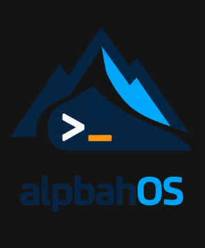

# alpbahOS

alpbahOS is a desktop Linux system built from Linux From Scratch (LFS) for x86_64 PCs with 32-bit multilib user space. It is for schools and for people moving from Windows. The default language is Turkish. The desktop is KDE Plasma with a Windows-style bottom taskbar and Start menu. Software comes from the `alp` package manager, KDE Discover, and Flathub.

## Status

- In development. Beta 0.9 test ISOs exist (latest in CURRENT.md: round 20). None is published, and there is no release yet.
- Base: the rebuilt LFS 13.1 / BLFS 13.1 system with a KDE Plasma Wayland session (D145).
- The live ISO and the installer pass in QEMU on both BIOS and UEFI.
- Not tested yet: a real PC (USB boot, real Wi-Fi). The Beta 0.9 gate is not met.
- Current state and evidence: [CURRENT.md](CURRENT.md). Open work: [docs/BACKLOG.md](docs/BACKLOG.md).

## Documents

- [AGENT.md](AGENT.md): working rules for the agent (rules)
- [CURRENT.md](CURRENT.md): current state
- [docs/DECISIONS.md](docs/DECISIONS.md): decisions with IDs
- [docs/MASTER_PLAN.md](docs/MASTER_PLAN.md): plan and milestones
- [docs/BACKLOG.md](docs/BACKLOG.md): tasks, acceptance criteria, status
- [docs/WORKLOG.md](docs/WORKLOG.md): history (not rewritten)
- [docs/handoffs/ai/](docs/handoffs/ai/): session notes
- [docs/verification/](docs/verification/): test evidence and logs
- [docs/archive/](docs/archive/): old versions of the documents above

## Build and release

- Builds run locally. Release ISOs will be published on GitHub Releases (D107).
- Each release needs the user's approval.
- Open conflict: D108 says the repository stays private until the first alpha ISO is ready, but the repository is public on GitHub now. This is waiting for the user's decision (see "Blocked on the user" in [docs/BACKLOG.md](docs/BACKLOG.md)).

## License

- Project code: GPL-3.0, see [LICENSE](LICENSE) (D109).
- Third-party components keep their own licenses (D109).
