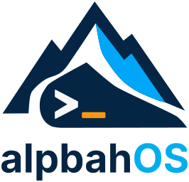
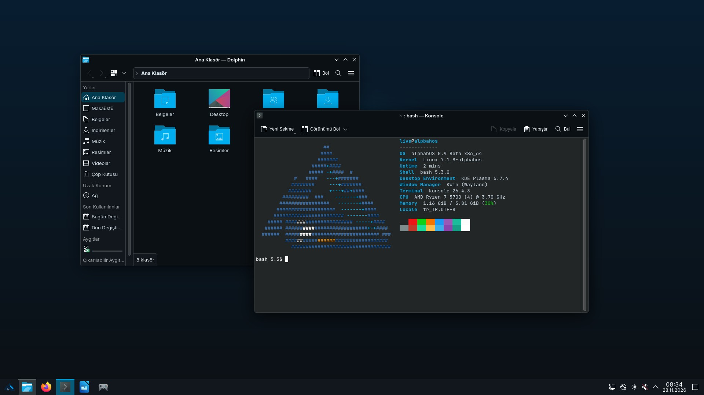

# alpbahOS

**Windows'tan geçenler ve okullar için Türkçe Linux.** Linux From Scratch tabanında sıfırdan derlenmiş, KDE Plasma
(Wayland) masaüstü, Windows'taki gibi alt görev çubuğu ve Başlat menüsü. Ücretsiz ve açık kaynak (GPL-3.0).

> alpbahOS şu an **beta 0.9**: günlük kullanımda deneniyor, ama henüz kararlı sürüm yok. Önemli dosyalarını yedekle.

## İndir

En yeni test ISO'su **R53e** (28 Kasım 2026):

- **İndirme:** [Internet Archive · alpbahos-beta-0.9-r53e](https://archive.org/details/alpbahos-beta-0.9-r53e)
  (`alpbahos-beta-0.9-2026-11-28-r53e.iso`, 6,3 GB, tek dosya; sayfada torrent de var)
- **sha256:** `b87e8e480663d82348dc92fb7235277971466e169b94c12b84f2f67faa4f2b8d`
- **Sürüm notları:** [Releases](https://github.com/Yoursel71/alpbahOS/releases)
- **Duvar kâğıtları** (en yüksek çözünürlük + videolu): [R53d sayfasında zip](https://archive.org/details/alpbahos-beta-0.9-r53d)

## Kurulum

1. ISO'yu indir ve doğrula: `sha256sum alpbahos-beta-0.9-2026-11-28-r53e.iso`
   (Windows'ta `certutil -hashfile alpbahos-beta-0.9-2026-11-28-r53e.iso SHA256`).
2. USB belleğe yaz: [Ventoy](https://www.ventoy.net) ya da KDE ISO Image Writer. Secure Boot kapalı olmalı.
3. USB'den aç, masaüstündeki **alpbahOS'u Kur** simgesine çift tıkla. Kurulum Türkçe ve adım adım; Windows'un yanına da
   kurulabilir. Kurmadan önce verilerini yedekle.
4. İlk girişte **Hoş Geldin** uygulaması görünümü, güncellemeleri ve popüler uygulamaları (Discord, Spotify, Steam...)
   tek tıkla ayarlar.

Ayrıntılı rehber: **[yoursel71.github.io/alpbahOS](https://yoursel71.github.io/alpbahOS/)**

## Neler var

- **Tanıdık masaüstü:** Başlat menüsü, alt görev çubuğu, Win+E, Ctrl+Shift+Esc, Win+Shift+S (ekran görüntüsü panoya).
- **Windows programları:** `.exe`'ye çift tıkla; bilinen kurulumlar (Steam, Discord, Chrome...) önce Linux sürümünü önerir,
  diğerleri Wine ile açılır.
- **alp:** Türkçe paket yöneticisi. `alp ara spotify`, `sudo alp kur steam`, `sudo alp upgrade` (sistem, uygulamalar ve
  Flatpak tek komutta).
- **Oyun:** Steam, Proton-GE, Oyun Modu (tek tıkla performans), NVIDIA sürücüsü tek komutla (`sudo alp install nvidia`).
- **Sistem Kontrolü:** güncelleme, ses, internet ve servisleri tek pencerede denetler.
- **İmzalı otomatik güncellemeler:** yeni düzeltmeler ISO beklemeden gelir; açılışta bildirim, tek tıkla kurulum.
- **Türkiye'ye özel:** Türkçe arayüz ve Q klavye; Discord ve Roblox erişimi için zapret hazır ve açık gelir.

## Güncellemeler ve devlog

Kurulu sistemler güncellemeleri bu depodaki
[`system-updates-v1`](https://github.com/Yoursel71/alpbahOS/releases/tag/system-updates-v1) sürümünden alır (imzalı,
geri alınabilir). Her güncellemede ne değiştiği **[devlog/](devlog/)** klasöründe Türkçe yazılır.

## Hata bildir

[Issues](https://github.com/Yoursel71/alpbahOS/issues) sayfasından **Hata bildirimi** şablonunu kullan. Sürümünü
öğrenmek için: `alpbahos-update --check` ve `alp doctor`.

## Nasıl geliştiriliyor

alpbahOS tek kişilik bir proje ve **yapay zekâ yardımıyla** (Claude) geliştiriliyor: derleme betikleri, paket yöneticisi,
testler ve belgeler bu şekilde yazılıyor; kararları ve testi proje sahibi yapıyor. Her sürüm yayımlanmadan önce sanal
makinede kurulup açılıyor, önemli değişiklikler gerçek bilgisayarda (Ryzen 7 5700, RTX 5060) deneniyor.

Kaynak kod, derleme betikleri, kararlar ve test kayıtları ayrı bir depoda açık:
**[Yoursel71/alp-development](https://github.com/Yoursel71/alp-development)**. Eski test sürümleri (R52 ve öncesi, parçalı
ISO) de orada.

## Lisans

GPL-3.0 ([LICENSE](LICENSE)). İçindeki üçüncü taraf yazılımlar kendi lisanslarını korur.
