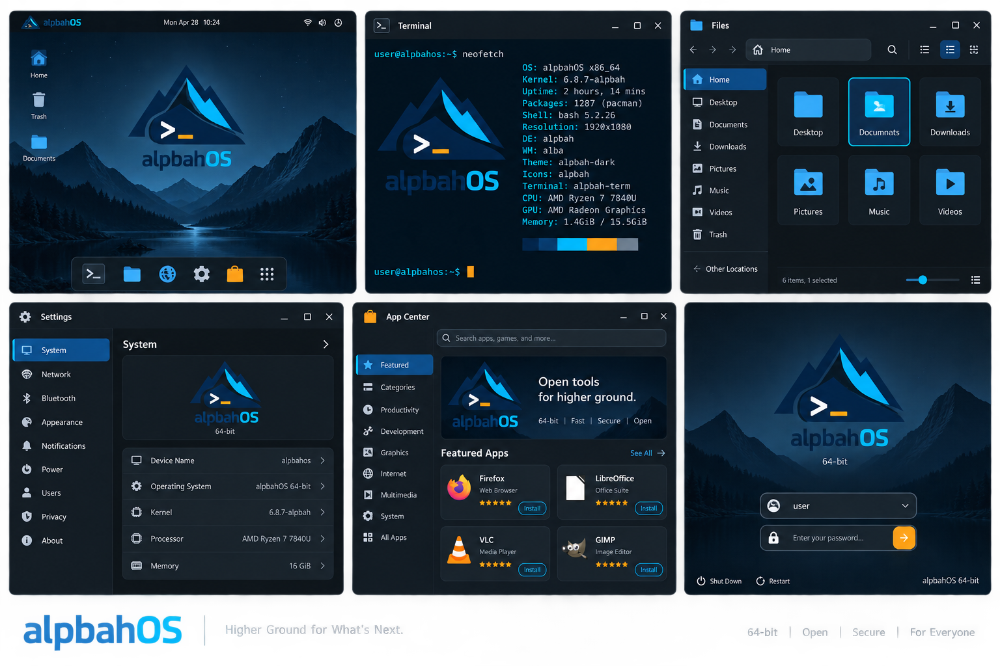
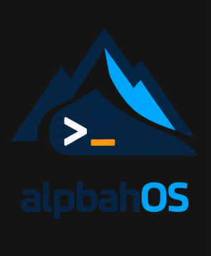

# alpbahOS Design Mockup Specification

**Version:** 0.1<br>
**Date:** 21 September 2026<br>
**Platform:** alpbahOS 64-bit<br>
**Status:** Concept design / design system before implementation

> **Status (2026-11-06).** Design reference from September 2026. The layout part is superseded: alpbahOS now uses a Windows-style bottom taskbar with a Start menu (D115), the Atatürk theme is selectable with the alpbahOS brand as default (D114), and Liquid glass is not in the first release (D116). Colours, logo and component styling remain valid (D113).

> 21 September 2026 update: current product decisions are in the [master plan](MASTER_PLAN.md). Existing screen layouts are kept; the default theme is the premium minimalist `alpbah-solid`, the desktop and lock-screen background is Atatürk, the language is Turkish and the keyboard is Turkish Q. Glass/Liquid remains as an option (superseded by D116: Liquid is not in the first release). Kernel, package count and system information in this document are mockup examples; they are not information about an installed system. Terminal logo/ANSI assets will be checked again in a real terminal before production.

## 1. Design summary

### Accepted layout reference



This image is the layout and colour reference. Texts, hardware information and application capabilities are replaced with real system information during implementation. The Atatürk default background and the Turkish interface decision are in the master plan.

alpbahOS is a dark, technical Linux desktop experience centred on a mountain silhouette, a terminal image and the `alpbahOS` wordmark.

Main design goals:

- Give a first impression of a Linux and developer-oriented system.
- Keep the same visual language across desktop, terminal and system applications.
- Make dark surfaces readable with electric blue and controlled orange accents.
- Keep the interface attractive but simple and fast for daily use.
- Show the 64-bit product identity as a technical detail, without filling the interface with it.

Main brand idea:

> **alpbahOS — Higher Ground for What's Next.**

This slogan may be used as supporting text in mockups; it is not required in the product interface.

## 2. Logo and brand use

### 2.0 Reference logo



Source file: [alpbahOS-logo.png](assets/alpbahOS-logo.png)

### 2.1 Logo structure

The logo has three main parts:

1. Dark navy mountain silhouette.
2. Electric blue peak/light shape.
3. Terminal command mark and orange cursor line.

The wordmark is written as `alpbahOS`: lowercase brand name with a capital `OS` suffix.

### 2.2 Logo variants

| Variant | Use |
|---|---|
| Full-colour logo | Desktop wallpaper, login screen, App Center banner |
| Single-colour light logo | Small sizes on dark backgrounds |
| Symbol-only logo | Dock (superseded by D115), window title, system tray, favicon |
| Logo with 64-bit badge | System information, installer and About screen |

### 2.3 Clear space

Leave clear space around the logo of at least `0.25x` the symbol height. The logo must not touch a window edge, a button or another icon.

### 2.4 Usage to avoid

- Compressing the mountain shape horizontally.
- Turning the electric blue into purple or green.
- Removing the terminal image or breaking the brand proportions.
- Adding shadow, glow or heavy 3D effects to the logo.
- Using `alpbahos`, `AlpbahOS` or `ALPBAHOS` as the main brand name.

### 2.5 Neofetch ASCII logo

A simple ASCII version for terminal information tools such as Neofetch:

```text
                 ${c1}                 /\\
                 ${c1}                /  \\
                 ${c1}       /\\      /    \\       /\\
                 ${c1}      /  \\    /      \\     /  \\
                 ${c1}  /\\ /    \\__/        \\___/    \\
                 ${c1} /  V                    ${c2}\\      \\
                 ${c1}/        ${c4}                    ${c2}\\      \\
                 ${c1}\\      ${c4}       ${c2} /\\              \\
                 ${c1} \\____${c4}      ${c2} /  \\____          /
                 ${c1}      \\____${c2}/        \\________/
                 ${c1}          ${c2}\\          /
                 ${c1}           \\________/
                 ${c1}          .-========-.
                 ${c1}         /  ${c2}>_      ${c1}\\
                 ${c1}        /      ${c3}__    ${c1}\\
                 ${c1}        \\____${c3}/  \\__${c1}/
                 ${c1}             ${c3}\\__/

                 ${c1}        a l p b a h ${c2}O${c2}S
                 ${c4}        6 4 - b i t  •  L i n u x
```

For the Neofetch configuration, these colour variables are suggested:

```bash
# ~/.config/neofetch/config.conf
ascii_distro=""
ascii_bold="on"
colors=(4 6 7 3 4 6)
```

Colour mapping:

- `${c1}`: dark navy / mountain silhouette.
- `${c2}`: electric blue / terminal and `OS`.
- `${c3}`: orange / cursor and small accent.
- `${c4}`: light cyan or white / brand subtitle and light layer.

The ASCII logo is designed not to exceed 24 characters, so it is not cut off in narrow terminal windows. For a better result, use a monospace terminal font and a window at least 80 columns wide.

### 2.6 Coloured ASCII from the real logo

In addition to the hand-drawn fallback, there is a Python tool that reads the real alpbahOS PNG logo pixel by pixel and converts it to ANSI truecolor half-block characters.

Files:

- [Generator Python tool](assets/generate_neofetch_ascii.py)
- [Coloured ANSI logo output](assets/alpbahOS-neofetch-ansi.txt)
- [ASCII terminal preview](assets/alpbahOS-neofetch-preview.png)

To generate:

```bash
python assets/generate_neofetch_ascii.py \
  assets/alpbahOS-logo.png \
  assets/alpbahOS-neofetch-ansi.txt \
  --width 48
```

To display it in a terminal:

```bash
cat assets/alpbahOS-neofetch-ansi.txt
```

This version keeps the mountain silhouette, cyan peak, terminal symbol, orange cursor and `alpbahOS` text of the logo image with their colours. `--width 48` is recommended for normal terminal use; `--width 64` for wider screens.

## 3. Visual language

### 3.1 Colour tokens

```css
:root {
  --ab-bg-950: #0b1014;
  --ab-bg-900: #11171c;
  --ab-surface-800: #16232d;
  --ab-surface-700: #1d2c38;
  --ab-border: #29404f;

  --ab-navy: #062746;
  --ab-navy-strong: #031a31;
  --ab-cyan: #00aeef;
  --ab-cyan-soft: #54d6ff;
  --ab-orange: #f5a623;
  --ab-orange-soft: #ffc45d;

  --ab-text-strong: #f4f8fb;
  --ab-text: #d4e0e8;
  --ab-text-muted: #8ea2af;
  --ab-text-disabled: #53636d;

  --ab-success: #35d07f;
  --ab-warning: #f5a623;
  --ab-danger: #ff6575;
  --ab-info: #4fc9ff;
}
```

Colour usage ratio:

- `60%` graphite / dark background.
- `25%` navy surfaces.
- `10%` electric blue.
- `5%` orange accent.

Orange should be used only for the active cursor, the primary action, warnings, or small points that need attention.

### 3.2 Typography

- Primary font: **Inter** or an equivalent sans-serif on the system.
- Terminal font: **JetBrains Mono** or **Cascadia Code**.
- Heading weights: 600–700.
- Body text: 400–500.
- Technical values: monospace, 400–600.

Suggested sizes:

| Token | Size | Use |
|---|---:|---|
| `display` | 32 px | Login screen or large banner |
| `title` | 22 px | Application title |
| `heading` | 16 px | Section heading |
| `body` | 14 px | Standard text |
| `label` | 12 px | Supporting information, badge |
| `caption` | 11 px | Secondary information |
| `terminal` | 14 px | Terminal lines |

### 3.3 Shape and spacing

- General corner radius: `10 px`.
- Card corner: `12 px`.
- Large modal corner: `16 px`.
- Small badge and status dot: `999 px`.
- Base spacing unit: `4 px`.
- Standard inner padding: `16 px`.
- Large panel inner padding: `24 px`.

Surfaces must be separated by a tone difference, not only by a line. A thin `1 px` cyan border is used only for selected or focused components.

## 4. Overall system theme

### 4.1 Desktop layout (top panel and dock superseded by D115)

The desktop consists of a top panel (superseded by D115), basic system icons on the left, and a bottom/centre dock (superseded by D115). The current layout is the Windows-style bottom taskbar with a Start menu (D115).

Top panel (superseded by D115):

- Left: small alpbahOS symbol and the active application name.
- Centre: date and time.
- Right: network, sound, battery/power and quick settings.
- Panel height: `32–36 px`.
- Background: semi-transparent `--ab-bg-950`.

Desktop:

- Dark mountain and lake themed wallpaper.
- The logo on the wallpaper is large but low-contrast and usable.
- Desktop icons are simple, with a cyan outline; their labels are light grey.

Dock (superseded by D115):

- Centred, or left-aligned depending on the user's choice.
- Icons for Terminal, Files, Web, Settings, App Center and the application menu.
- Small cyan line under the active application.
- Orange bag symbol for App Center.

### 4.2 Window behaviour

- Title bar: dark navy/black surface.
- Window control icons at the top right.
- Active window border: `--ab-cyan`, 1 px.
- Inactive window border: `--ab-border`.
- Windows have a light shadow; heavy blur and strong glass effects must not be used.

### 4.3 System menu

The quick system menu must contain these groups:

- Wi-Fi / Ethernet.
- Volume.
- Screen brightness.
- Night light.
- Bluetooth.
- Power and session options.

Menu cards are visible on `--ab-surface-800`. Selected state is cyan; attention state is orange.

## 5. Mockup 01 — Desktop home screen

### Purpose

Define the main work area the user sees after signing in.

### Composition

- 16:9 screen.
- Wallpaper: night mountains, a lake and a light blue sky.
- Middle/right area: a slightly large alpbahOS symbol.
- Top left: `Home`, `Trash`, `Documents` icons.
- Centre bottom: dock (superseded by D115).

### Content

- Clock display in the top panel (superseded by D115) in the format `Mon Apr 28 10:24`.
- Dock order (superseded by D115): Terminal, Files, Browser, Settings, App Center, Applications.
- Cyan underline for the active application.
- Connection and sound icons at the top right.

### Interaction

- Small tooltip when the mouse is over a dock icon (superseded by D115).
- The icon gets a short orange highlight while an application is opening.
- Clicking the system area at the top right opens the quick settings panel.
- Right-clicking the desktop shows `New folder`, `Change wallpaper` and `Display settings`.

### Acceptance criteria

- The logo is readable on the wallpaper but does not cover the work area.
- The dock is visible on both light and dark wallpapers (superseded by D115).
- Desktop icons turn cyan when selected; critical actions such as deleting show an orange warning.

## 6. Mockup 02 — Terminal

### Purpose

Show the basic work area for developers and advanced users.

### Composition

- Dark navy/black terminal surface.
- Terminal symbol and `Terminal` title at the top left.
- Standard window control buttons at the top.
- Monospace text inside the terminal.

### Example content

```text
user@alpbahos:~$ neofetch

OS:       alpbahOS x86_64
Kernel:   6.8.7-alpbah
Uptime:   2 hours, 14 mins
Packages: 1287 (alp)
Shell:    bash 5.2.26
DE:       alpbah
WM:       alba
Theme:    alpbah-dark

user@alpbahos:~$ _
```

The values above are mockup examples, not the output of an installed system.

### Colours

- Prompt user name: cyan.
- Command line: light grey.
- Successful output: cyan or green.
- Warning: orange.
- Error: red.
- Cursor: orange rectangle.

### Interaction

- Tabs are separated by a cyan line.
- Active tab is cyan; inactive tab is muted text.
- Search and copy tools can be found in the title bar.
- Terminal selection uses the system highlight; the text colour may be dark navy.

## 7. Mockup 03 — Files

### Purpose

Make file management simple and capable for everyday users.

### Composition

- Left navigation column.
- At the top: back/forward, location field and search.
- View switch icons on the right.
- Large folder cards in the middle area.

### Navigation

- Home
- Desktop
- Documents
- Downloads
- Pictures
- Music
- Videos
- Trash
- Other Locations

### Visual behaviour

- Folder icons are cyan/blue.
- Selected folder: cyan border and dark blue background.
- Delete and trash actions are shown with an orange or red status colour.
- File previews are simple; card surfaces use `--ab-surface-800`.

### Interaction

- Single click selects, double click opens.
- When dragging and dropping, the target folder is marked with a cyan glow.
- For large file copies, a progress bar in the bottom information area.
- On the dark interface, icons must have sufficient contrast.

## 8. Mockup 04 — Settings / Control Center

### Purpose

Present the system personalisation and management screens in one consistent structure.

### Left menu

- System
- Network
- Bluetooth
- Appearance
- Notifications
- Power
- Users
- Privacy
- About

### System screen

Main cards:

- Device name: `alpbahos`.
- Operating system: `alpbahOS 64-bit`.
- Kernel version.
- CPU information.
- Memory capacity.
- Graphics processor.

### Appearance screen

Controls:

- Light/dark theme, default dark.
- Cyan accent intensity.
- Orange accent usage.
- Dock position (superseded by D115).
- Wallpaper.
- Window corner rounding.
- Reduce animations.

### Interaction

- The active item in the left menu is marked with a cyan border.
- Changes are previewed immediately where possible.
- For risky system changes, a clear confirmation dialog is used.

## 9. Mockup 05 — App Center

### Purpose

Combine application discovery, installation and updates with the brand language.

### Composition

- Left category menu.
- Wide search field at the top.
- alpbahOS banner for featured applications.
- Application cards in the lower section.

### Categories

- Featured
- Categories
- Productivity
- Development
- Graphics
- Internet
- Multimedia
- System
- All Apps

### Application card

Each card contains:

- Application icon.
- Application name.
- Short description.
- Rating.
- Size or source information.
- `Install`, `Update` or `Open` button.

### Colour behaviour

- Install: cyan border or cyan fill.
- Update: orange accent.
- Open: green or cyan.
- Security warning: orange icon and description.

### Featured banner

The banner may use the logo and a message such as:

> Open tools for higher ground.

Footer: `64-bit · Fast · Secure · Open`.

## 10. Mockup 06 — Login and start screen

### Purpose

Create a strong and calm brand experience in the first seconds of the system.

### Composition

- Full-screen mountain and lake wallpaper.
- Full alpbahOS logo in the centre.
- `64-bit` information below the logo.
- User selection area.
- Password field and orange arrow button.
- `Shut Down` and `Restart` options at the bottom.

### Interaction

- Cyan border when the password field is focused.
- Orange login submit button.
- On a wrong login, a short red warning and explanatory text.
- On a successful login, the logo shrinks slightly and the screen transitions to the desktop.

## 11. Shared component library

### Buttons

| Type | Appearance | Use |
|---|---|---|
| Primary | Cyan fill, dark text | Install, Save, Open |
| Secondary | Dark surface, cyan border | Secondary action |
| Accent | Orange fill | Sign in, important action |
| Ghost | No background | Cancel, helper action |
| Danger | Red accent | Delete, irreversible action |

### Form fields

- Normal: `--ab-surface-700` background, `--ab-border` line.
- Focused: cyan border and a light cyan glow.
- Error: danger border and a description below the field.
- Disabled: low contrast, text description kept.

### Notifications

- Success: green dot/icon.
- Information: cyan.
- Warning: orange.
- Error: red.

Notifications must not stay on screen for long; important warnings must be persistent and dismissible.

## 12. Responsive design and scaling

### Desktop

- Minimum target: `1280 × 720`.
- Recommended: `1920 × 1080`.
- High density: on 2x screens, icons and text must not look blurred.

### Small screen

- Left menus can be collapsed.
- Dock icons become smaller, but the touch target does not go below `40 px` (superseded by D115).
- App Center cards fall back to a single column.
- The Files view can switch to list mode.

### Accessibility

- At least WCAG AA contrast for normal text.
- States must not be described by colour alone; an icon or text must be added.
- Keyboard focus must always be visible.
- The reduce-animation setting must be supported.
- The terminal and file management must be fully usable with the keyboard.

## 13. Animation principles

- Window opening: `120–160 ms`, ease-out.
- Menu opening: `100–140 ms`.
- Dock hover: `100 ms` (superseded by D115).
- App Center loading state: smooth progress animation.
- Transition from login screen to desktop: `250–350 ms`.

Animations should explain the interface; continuous flashing and loops that distract must not be used.

## 14. Wallpaper direction

Main wallpaper:

- Night mountains and a lake.
- Mostly navy tones.
- Cyan light on the mountain peak.
- Very little orange warmth on the horizon.
- A low-detail empty area in the centre behind the icons.

Alternatives:

1. Simple dark navy gradient.
2. Geometric mountain lines.
3. Abstract mountain made from terminal characters.
4. High-contrast accessible wallpaper.

## 15. Application theme guidelines

Every alpbahOS application must follow these shared rules:

- Title bar and window controls must be common.
- Search field, tab, button and notification styles must come from the same tokens.
- The application icon is based on cyan/blue, and may have small orange details.
- If an application has its own colour, the accent must not completely suppress the alpbahOS cyan.
- System settings and the application store may use more cyan; the terminal should stay plainer.

Suggested application theme names:

- `alpbah-dark` — default dark theme.
- `alpbah-midnight` — darker theme with lower brightness.
- `alpbah-contrast` — high-contrast accessible theme.
- `alpbah-light` — light theme to be added later; navy text, light grey surfaces and cyan accent.

## 16. Technical implementation notes

- Colour and spacing tokens must be managed from a single central theme file.
- System icons are kept as SVG or an equivalent scalable format.
- The logo must be used from a vector source at production time, not as a raster.
- App Center and Settings components must be fed from a common UI library.
- The window theme must load the system tokens before an application's own style.
- Terminal colours must match the ANSI colour palette.
- On a dark theme, a surface tone difference is preferred over shadow.

## 17. Design delivery list

Files to prepare before production:

- Logo SVG: full colour, single colour, symbol-only.
- Logo PNG: 16, 24, 32, 48, 64, 128, 256, 512 px.
- App Center banner.
- Login screen background.
- Default desktop wallpaper.
- System icon set.
- Application icon template.
- Colour and typography token file.
- Desktop mockup.
- Terminal mockup.
- Files mockup.
- Settings mockup.
- App Center mockup.
- Login screen mockup.

## 18. Final acceptance criteria

When the design set is complete:

- All screens must look like they belong to the same alpbahOS product at first glance.
- The `alpbahOS` wordmark must be spelled correctly everywhere.
- The roles of the cyan and orange accent colours must not be mixed up.
- Shared component behaviour must be kept across Terminal, Files, Settings and App Center.
- The 64-bit information must be visible but must not be a dominant detail.
- The dark theme must be both attractive and readable.
- Keyboard focus, contrast, error messages and non-colour status markers must be implemented.
- Mockups must contain enough size and behaviour detail to be turned into real application components.

---

## Short decision summary

alpbahOS's default visual identity should be built on **dark graphite surfaces + navy mountain + electric blue accent + a small orange interaction mark**. The desktop, terminal, Files, Settings, App Center and login screen must use the same design tokens; differences should come only from the application's function.
